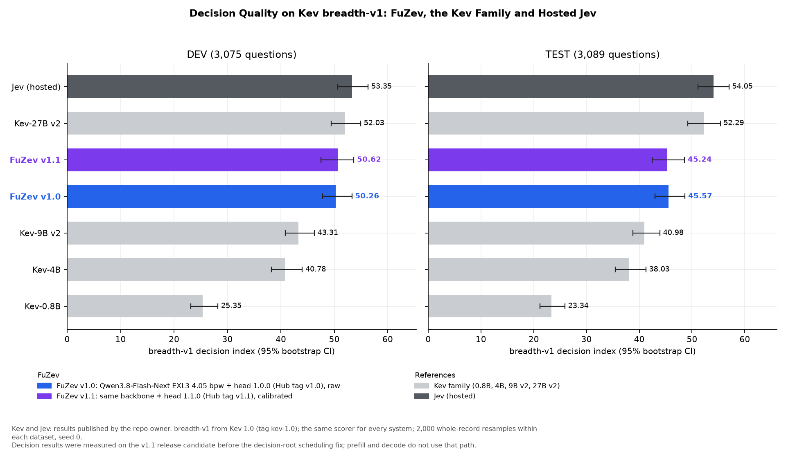

# FuZev

**Weights on Hugging Face:** [peisongxiao/Qwen3.8-Flash-Next-FuZev](https://huggingface.co/peisongxiao/Qwen3.8-Flash-Next-FuZev/tree/v1.1)

FuZev adds Choice, yes/no (Noul) and Score decisions to an ExLlamaV3 server
through the Jev SystemOne API. A small shared head reads the model's final hidden
state and label logits alongside normal generation.

## Key Highlights

- **Load once, generate and decide.** Text generation and
  [decisions](docs/api.md) share one copy of the weights, one KV cache and one
  scheduler.
- **No fine-tuning.** The [backbone](#head-and-backbones) stays frozen. A
  2.9M-parameter head reads its final hidden state, and the label logits for
  up to 26 options, to make decisions.
- **256K context, image input and shared prefixes.** By default the launcher
  serves the backbone's full context, a
  [262,143-token window](docs/install.md#verified-source-installations).
  Requests can carry [images](docs/api.md#images) (experimental), and decisions
  can pick up a generated conversation through its
  [retained prefix](docs/api.md#retained-prefixes), reusing the engine's prefix cache.
- **Mixture-of-experts backbone.**
  [Qwen3.8-Flash-Next](https://huggingface.co/Qwen/Qwen3.8-Flash-Next) activates
  6B of its 125B parameters per token. Kev 1.0's
  [released decision models](https://github.com/jaredpalmer/kev/blob/kev-1.0/README.md#models) are all dense.
- **Ahead of Kev-9B with fewer active parameters.** On Kev's held-out
  [`breadth-v1` TEST](#kev-breadth-v1), FuZev with Qwen3.8-Flash-Next (6B
  active) scores 45.24 [42.46, 48.58] to dense Kev-9B v2's 40.98 [38.82,
  43.90]. On DEV, a paired 95% bootstrap (2,000 resamples, seed 0) puts FuZev
  3.75 to 10.30 index points ahead; Kev publishes no TEST predictions, so TEST
  has no paired comparison. Kev-27B and Jev score higher.
- **Faster prefill.** On one NVIDIA GB10, FuZev's [prefill](#prefill-speed)
  runs 16% to 42% faster than ExLlamaV3 at its default configuration, on
  prompts of 2K to 64K tokens.
- **One head across quantizations.** The same head file serves the EXL3
  [4.05 and 3.05 bpw](#results) checkpoints. The 1.0 head was tested on
  [five quantizations in six engine setups](https://github.com/PeisongXiao/fuzev-research-archive/blob/v1.1/docs/benchmarks-v1.0.md#selection-and-modality).

Decision results were measured on the v1.1 release candidate before the
decision-root scheduling fix; prefill and decode do not use that path.

> **One machine. One model load. Text generation and decisions.**

**Contents**

- [Use](#use)
  - [ExLlamaV3 With EXL3](#exllamav3-with-exl3)
  - [Send A Request](#send-a-request)
- [Train Your Own Head](#train-your-own-head)
- [Results](#results)
  - [Six Configurations: 5,075 Requests](#six-configurations-5075-requests)
  - [Kev breadth-v1](#kev-breadth-v1)
  - [Prefill Speed](#prefill-speed)
- [What's New In v1.1](#whats-new-in-v11)
- [Components](#components)
- [Head And Backbones](#head-and-backbones)
- [Limitations](#limitations)
- [License](#license)

## Use

Run the steps below in one shell. They fetch the head from
[peisongxiao/Qwen3.8-Flash-Next-FuZev](https://huggingface.co/peisongxiao/Qwen3.8-Flash-Next-FuZev/tree/v1.1)
with `hf download`. An existing head directory also works.

### ExLlamaV3 With EXL3

Run the [Create An Environment](docs/install.md#create-an-environment),
[ExLlamaV3 engine](docs/install.md#exllamav3) and
[ExLlamaV3 With EXL3](docs/install.md#exllamav3-with-exl3) installation steps.
The build needs the CUDA toolkit (`nvcc`). Then download the head and
turboderp's EXL3 4.05 bpw pack, and start the server.

```bash
hf download peisongxiao/Qwen3.8-Flash-Next-FuZev --revision v1.1 --local-dir fuzev-head
hf download turboderp/Qwen3.8-Flash-Next-exl3 \
  --revision 55a732e0c4c3d4614bc42b68493bb930d9b02c0a --local-dir qwen-exl3
fuzev-native --model ./qwen-exl3 --head ./fuzev-head --model-name my-model \
  --calibration calibrated
```

The first request after startup is slower while the prefill kernels compile.
The server defaults to raw probabilities; `--calibration calibrated` applies
the head's fitted temperatures, as in the published results.

### Send A Request

The server listens on `127.0.0.1:8000`. [Server setup](docs/install.md#start-a-server)
covers listener options. From another terminal:

```bash
curl --fail-with-body http://127.0.0.1:8000/v1/systemone \
  -H 'Content-Type: application/json' \
  -d '{"state":"Please refund the duplicate charge.","questions":{"refund":{"type":"noul","instructions":"Does the customer request a refund?"}}}'
```

The response holds `model`, the probability `answers.refund.noul` and token `usage`.
The [API reference](docs/api.md) covers the TypeSafe SDK, errors, retained
prefixes and experimental image inputs.

## Train Your Own Head

Train a head for your model of choice with the [training guide](https://github.com/PeisongXiao/fuzev-research-archive/blob/v1.1/docs/train-a-shared-head.md) in
the research archive. The guide extracts features from a frozen Hugging Face
model, trains and calibrates the head, and exports a `fuzev-runtime` bundle.

- Your head loads and scores through the [runtime Python API](https://github.com/PeisongXiao/fuzev-runtime/blob/v1.1/README.md#scoring-from-python).
- The ExLlamaV3 server serves the `fuzev-candidate-branches-v1` and
  `fuzev-list-aware-v2` [encodings](docs/models.md#encodings).

## Results

All decision runs use NVIDIA GB10 and a 2,872,401-parameter head.

- FuZev with Qwen3.8-Flash-Next scores 45.24 [42.46, 48.58] on `breadth-v1`
  TEST: above Kev-0.8B, Kev-4B and Kev-9B v2, below Kev-27B and Jev (unpaired
  intervals; the Kev-9B v2 intervals overlap). On DEV, a paired 95% bootstrap
  puts FuZev 3.75 to 10.30 index points ahead of Kev-9B v2. FuZev trains only
  a head; Kev fine-tunes backbone LoRA adapters or the full backbone.
- Text decision quality is unchanged from v1.0 overall within the 95% CI;
  CLINC150 drops 8.7 points on both splits ([full table](docs/benchmarks.md#text-decisions)).
- On held-out WANDS product search (189 requests in 56 query groups), head
  1.1.0 ranks an acceptable product first in 38/56 requests at 26 options and
  24/35 at 255 options (uniform control 2/35); its calibration error exceeds
  the uniform control at 64 or more options
  ([per-option-count table](https://huggingface.co/peisongxiao/Qwen3.8-Flash-Next-FuZev/blob/v1.1/README.md#held-out-wands)).
- At 4.05 and 3.05 bpw, the same 12 decision pairs pick the same winner in
  10 ([paired results](https://github.com/PeisongXiao/fuzev-research-archive/blob/v1.1/docs/v1.1-head-results.md#paired-bitrate-api)).
- In the 1.0 head's research study, all six configurations' DEV index
  intervals overlap.
- Paired against the frozen-LM label control (the backbone's label logits without
  the head), the 1.0 head gains +4.4 [2.0, 6.4] index points.
- ExLlamaV3 repeats within one server are identical. Four questions decided
  concurrently differ from the same questions decided one at a time by up to
  0.048 raw and 0.042 calibrated probability
  ([record](https://github.com/PeisongXiao/fuzev-research-archive/blob/v1.1/docs/results/integration/v1.1/decision-root-concurrency.json)).
  In the 1.0 head's research study, vLLM repeats shift probabilities by up to
  0.25, and about 15% of decisions on shared requests differ between NVIDIA
  NVFP4 runs ([repeat probes](docs/benchmarks.md#repeat-probes)).

### Six Configurations: 5,075 Requests

These research runs use the 1.0 head, raw probabilities and pre-release builds
of the archived research evaluation servers
([v1.0 quality study](https://github.com/PeisongXiao/fuzev-research-archive/blob/v1.1/docs/benchmarks-v1.0.md)).
Each run sends 2,000 held-out evaluation-mix requests and 3,075 Kev DEV questions
to the HTTP server ([recorded settings](docs/models.md#recorded-benchmark-settings)).

| Configuration | Checkpoint | Completed Requests | `breadth-v1` DEV Index [95% CI] (3,075 questions) | Evaluation-Mix Selection (2,000) |
| --- | --- | ---: | --- | ---: |
| ExLlamaV3 EXL3 3.05 bpw | [turboderp@69e33439](https://huggingface.co/turboderp/Qwen3.8-Flash-Next-exl3/tree/69e33439ae950f17bcbe95c98f117d80f759ab6d) | 5,075/5,075 | 50.5 [48.0, 53.6] | 76.05% |
| ExLlamaV3 EXL3 4.05 bpw | [turboderp@55a732e0](https://huggingface.co/turboderp/Qwen3.8-Flash-Next-exl3/tree/55a732e0c4c3d4614bc42b68493bb930d9b02c0a) | 5,075/5,075 | 50.0 [47.6, 53.0] | 78.40% |
| ExLlamaV3 EXL3 5.05 bpw | [turboderp@7cef615f](https://huggingface.co/turboderp/Qwen3.8-Flash-Next-exl3/tree/7cef615f7fd3681295b68848018876dfabc336c7) | 5,075/5,075 | 50.3 [48.0, 53.4] | 77.25% |
| vLLM NVIDIA NVFP4 | [NVIDIA@fc694b54](https://huggingface.co/nvidia/Qwen3.8-Flash-Next-NVFP4/tree/fc694b54fb0174e0913e6adf86691ef85a4ead47) | 5,075/5,075 | 49.7 [47.2, 52.9] | 77.45% |
| vLLM RadixArk NVFP4 | [RadixArk@7b719225](https://huggingface.co/RadixArk/Qwen3.8-Flash-Next-NVFP4/tree/7b719225242aacd3dbd3f9407468c2ee9a9d2594) | 5,075/5,075 | 52.3 [49.9, 55.4] | 76.45% |
| vLLM EXL3 4.05 bpw | [turboderp@55a732e0](https://huggingface.co/turboderp/Qwen3.8-Flash-Next-exl3/tree/55a732e0c4c3d4614bc42b68493bb930d9b02c0a) | 5,075/5,075 | 50.1 [47.7, 53.3] | 77.80% |

### Kev `breadth-v1`

Kev and Jev: results published by the repo owner. `breadth-v1` from Kev 1.0.




| System | Backbone | `breadth-v1` TEST Index | 95% CI |
| --- | --- | ---: | --- |
| [Kev-0.8B](https://github.com/jaredpalmer/kev/blob/kev-1.0/runs/fam-breadth-test-report/report.json) | Qwen3.5-0.8B-Base, dense | 23.34 | [21.21, 25.91] |
| [Kev-4B](https://github.com/jaredpalmer/kev/blob/kev-1.0/runs/fam-breadth-test-report/report.json) | Qwen3.5-4B-Base, dense | 38.03 | [35.49, 41.26] |
| [Kev-9B v2](https://github.com/jaredpalmer/kev/blob/kev-1.0/runs/fam-breadth-test-report/report.json) | Qwen3.5-9B-Base, dense | 40.98 | [38.82, 43.90] |
| **FuZev with Qwen3.8-Flash-Next (ExLlamaV3 + 4.05 bpw)** | Frozen MoE: 125B total, 6B active, plus n-gram embeddings | **45.24** | [42.46, 48.58] |
| [Kev-27B](https://github.com/jaredpalmer/kev/blob/kev-1.0/runs/fam-breadth-test-report/report.json) | Qwen3.8-27B, dense | 52.29 | [49.22, 55.35] |
| [Jev](https://github.com/jaredpalmer/kev/blob/kev-1.0/runs/r23-breadth-report/report.json) | Hosted, undisclosed | 54.05 | [51.15, 57.01] |

FuZev setup: ExLlamaV3 HTTP server, 4.05 bpw, MTP 3, batch 4 (v1.1 with
Q8 KV cache), each Kev record's questions in one SystemOne request. FuZev
v1.1 uses head 1.1.0 calibrated; v1.0 uses head 1.0.0 raw
([setup, methods and records](docs/benchmarks.md#setup)).
Decision results were measured on the v1.1 release candidate before the
decision-root scheduling fix; prefill and decode do not use that path.

Methods, controls, DEV comparisons, lowest results and repeat probes:
[benchmarks](docs/benchmarks.md). Generation with decisions:
[integration checks](docs/integration.md). Timing: [performance](docs/performance.md).

### Prefill Speed


Measured on one NVIDIA GB10 (128 GB unified memory); Python 3.12.3,
PyTorch 2.13.0+cu130, Triton 3.7.1, FlashInfer 0.6.18.post1;
exllamav3-fuzev 1.6.1+fuzev.v1.1 and 1.5.2+fuzev.v1.0,
ExLlamaV3 1.6.2 and ExLlamaV3 master (058b8630). Batch 1, Q8 KV cache,
32,768-token chunks, 98,304-token context and cache, FP32 recurrent state
(upstream also shown at its FP16 default), MTP component loaded; one
warmup and two measured repetitions per point.

[Performance](docs/performance.md) reports all repetitions and settings.
FuZev's prefill defaults are tuned on GB10; `fuzev-native --prefill-profile`
overrides them on other GPUs.

## What's New In v1.1

- ExLlamaV3 is the only serving engine; the vLLM components stay at 1.0.
  fuzev-exllamav3-plugin 1.0 and fuzev-vllm-plugin 1.0 pair with
  fuzev-runtime 1.0 only ([upgrading from 1.0](docs/releases.md#upgrading-from-10)).
- Head 1.1.0 (`--revision v1.1`) accepts 2 to 255 text options and 2 to 26
  image options for Choice and Score; text lists of more than 26 options use
  a numbered list ([capacity comparison](docs/api.md#capacity-comparison)).
- A decision reads its context and question once; each option then adds only
  its own tokens, up to `--max-batch-size` options at a time
  ([API limitations](docs/api.md#limitations)).
- `usage.input_tokens` counts the encoded request once; `/v1/decisions`
  reports logical branch work in `execution.submitted_tokens`
  ([API reference](docs/api.md#usage)).
- `fuzev-native --prefill-profile` sets prefill options before the model
  loads ([performance settings](docs/performance.md#settings)).
- The default prefill chunk is 32,768 tokens (8,192 in 1.0), capped at the
  cache tokens ([upgrading from 1.0](docs/releases.md#upgrading-from-10)).
- `breadth-v1` TEST scores come from served runs, where FuZev v1.0 scores
  45.57 [42.95, 48.67]. FuZev 1.0's published 46.8 [44.2, 50.0] is an offline
  score of the 1.0 head
  ([v1.0 quality study](https://github.com/PeisongXiao/fuzev-research-archive/blob/v1.1/docs/benchmarks-v1.0.md#test-controls-and-datasets)).
- Head 1.1.0's MM-RLHF best-response image accuracy is 56.7%, against 73.3%
  for FuZev 1.0 ([experimental image results](docs/benchmarks.md#experimental-image-decisions)).

[Releases](docs/releases.md#whats-new-in-v11) lists all changes, component
versions and upgrade steps.

## Components

| Component | Role |
| --- | --- |
| [fuzev-runtime](https://github.com/PeisongXiao/fuzev-runtime/tree/v1.1) | Head loading, scoring and SystemOne mapping |
| [fuzev-exllamav3-plugin](https://github.com/PeisongXiao/fuzev-exllamav3-plugin/tree/v1.1) | Decision API for a Generator and the `fuzev-native` launcher |
| [exllamav3-fuzev](https://github.com/PeisongXiao/exllamav3-fuzev/tree/v1.1) | ExLlamaV3 feature-readout hooks |
| [Research archive](https://github.com/PeisongXiao/fuzev-research-archive/tree/v1.1) | Training methods, evaluation and reproduction tools |
| [Qwen3.8-Flash-Next-FuZev](https://huggingface.co/peisongxiao/Qwen3.8-Flash-Next-FuZev/tree/v1.1) | Decision head weights, configuration and calibration (Hugging Face) |

## Head And Backbones

- [Head card](https://huggingface.co/peisongxiao/Qwen3.8-Flash-Next-FuZev/blob/v1.1/README.md): the shared
  2,872,401-parameter head, trained on Qwen3.8-Flash-Next EXL3 4.05 bpw.
- [Models](docs/models.md): backbone checkpoints and tested settings.
- [Releases](docs/releases.md): component versions.

## Limitations

- FuZev is an experimental research release.
- **Options:** Choice and Score accept 2 to `implemented_max` options (255 for
  text and 26 with an image in head 1.1.0); Noul has two
  ([capacity comparison](docs/api.md#capacity-comparison)). Text Score quality
  has no validated maximum in the bundle.
- **Platform:** Tested on NVIDIA GB10 (Python 3.12, PyTorch 2.13.0+cu130). ExLlamaV3
  needs CUDA; the head runs on CPU or CUDA ([verified source installations](docs/install.md#verified-source-installations)).
- **Quality evidence:** Quality runs use pre-release fork builds
  ([benchmark limitations](docs/benchmarks.md#limitations)).
- **Engine settings:** ExLlamaV3 readout runs without tensor parallelism
  ([API limitations](docs/api.md#limitations)).
- **Images:** Experimental (run at your own risk). Image Choice is validated
  at 2 options; image Noul, image Score and larger image option sets are
  unvalidated. Measured image results, including tracks where the head scores
  below the frozen-LM label control, are in
  [benchmarks](docs/benchmarks.md#experimental-image-decisions).
- **Repeatability:** ExLlamaV3 probabilities vary across server starts,
  prefix-cache states and concurrent execution
  ([repeat probes](docs/benchmarks.md#repeat-probes)).
- **Measured scope:** Quality is measured on the Results workloads. Quality at the
  server's full context length is unmeasured.

Research methods: [research archive](https://github.com/PeisongXiao/fuzev-research-archive/tree/v1.1).

## License

Index code and documentation: [Apache-2.0](LICENSE).
Copyright 2026 Peisong Xiao. The head has its own Apache-2.0 license.
[NOTICE](NOTICE) credits backbone and dataset terms.
