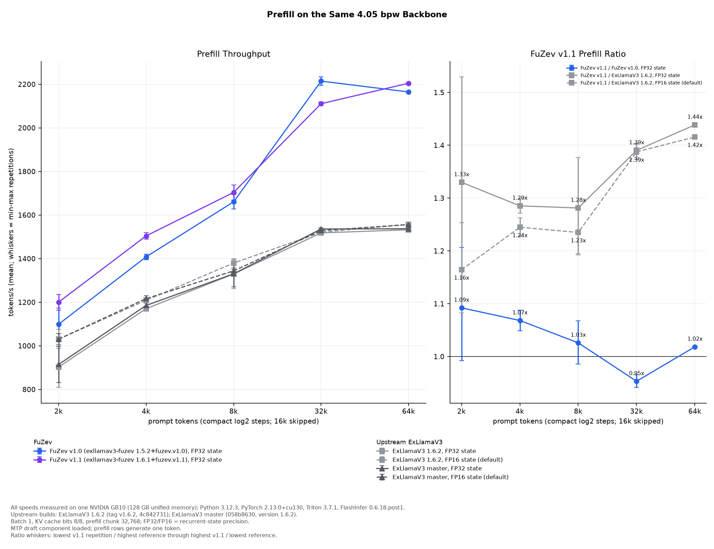

# ExLlamaV3 Prefill Performance

This benchmark times engine prefill of 2,048 to 65,536 prompt tokens on four
builds:

- **FuZev v1.1:** exllamav3-fuzev with its default [prefill profile](#settings).
- **FuZev v1.0:** exllamav3-fuzev v1.0 with its prefill optimizations.
- **ExLlamaV3 1.6.2 and master:** upstream ExLlamaV3 with plain prefill.

To serve generation and decisions, see the [installation guide](install.md).

## Setup

- **Platform:** one NVIDIA GB10 (DGX Spark, 128 GB unified memory), ARM64,
  Python 3.12.3, PyTorch 2.13.0+cu130 (CUDA 13.0), Triton 3.7.1, FlashInfer
  0.6.18.post1 (JIT cache 0.6.18.post1+cu130).
- **Build:** exllamav3-fuzev 1.6.1+fuzev.v1.1 and 1.5.2+fuzev.v1.0, with
  [the prefill optimizations from exllamav3-fuzev (`exllamav3.optimized`)](https://github.com/PeisongXiao/exllamav3-fuzev/blob/v1.1/doc/fuzev-fork.md#prefill-optimizations)
  enabled; ExLlamaV3 1.6.2 and ExLlamaV3 master (058b8630). The benchmark
  loads each build directly. FuZev v1.1 is based on ExLlamaV3 1.6.1, so
  comparisons with 1.6.2 include upstream changes.
- **Model settings:** Qwen3.8-Flash-Next EXL3 4.05 bpw; batch 1, Q8 KV cache,
  32,768-token chunks, 98,304-token context and cache, 90 GiB loader
  allowance; MTP component loaded, MTP off. FuZev runs FP32 recurrent state;
  each ExLlamaV3 build runs at its default FP16 and at FP32.
  [Models](models.md#backbones) lists checkpoint revisions; per-layer (n-gram)
  embeddings stream from disk.
- **Generation:** raw prompt tokens from an Apache-2.0 documentation corpus;
  temperature 1, top-p 0.95, top-k 20, seed 0; one requested output token.
  The JSON keeps observed prompt and output counts.
- **Runs:** one warmup and two measured runs per build and prompt length.
- **Prefix reuse:** each run uses a fresh Generator and a different prompt
  offset, with no cached tokens.
- **Concurrency:** the benchmark ran one request at a time. The released
  integration submits requests to the ExLlamaV3 Generator, which batches
  concurrent jobs; its concurrent prefill throughput is unmeasured.

## Measurements

The native rate is processed tokens divided by engine prefill time. Brackets
give the minimum and maximum of the two runs. Host wall ratio is the
reference build's mean wall time divided by FuZev v1.1's; values above 1 mean
lower FuZev wall time. Pair ranges compare runs at the same prompt offset.

| Prompt Tokens | Build | Rep 1 tok/s | Rep 2 tok/s | Mean [Min, Max] tok/s | Host Wall Ratio [Pair Range] |
| ---: | --- | ---: | ---: | ---: | ---: |
| 2,048 | FuZev v1.0 (FP32) | 1172.8 | 1024.9 | 1098.9 [1024.9, 1172.8] | 1.09 [1.05, 1.13] |
| 2,048 | FuZev v1.1 (FP32) | 1236.6 | 1163.7 | 1200.2 [1163.7, 1236.6] | 1.00 [1.00, 1.00] |
| 2,048 | ExLlamaV3 1.6.2 (FP32) | 996.4 | 808.5 | 902.4 [808.5, 996.4] | 1.33 [1.23, 1.43] |
| 2,048 | ExLlamaV3 1.6.2 (default FP16) | 1074.9 | 986.6 | 1030.8 [986.6, 1074.9] | 1.16 [1.14, 1.17] |
| 2,048 | ExLlamaV3 master (FP32) | 997.4 | 831.5 | 914.4 [831.5, 997.4] | 1.31 [1.23, 1.39] |
| 2,048 | ExLlamaV3 master (default FP16) | 1056.5 | 1003.9 | 1030.2 [1003.9, 1056.5] | 1.16 [1.15, 1.16] |
| 4,096 | FuZev v1.0 (FP32) | 1420.6 | 1395.6 | 1408.1 [1395.6, 1420.6] | 1.07 [1.07, 1.07] |
| 4,096 | FuZev v1.1 (FP32) | 1518.6 | 1490.0 | 1504.3 [1490.0, 1518.6] | 1.00 [1.00, 1.00] |
| 4,096 | ExLlamaV3 1.6.2 (FP32) | 1171.4 | 1169.3 | 1170.3 [1169.3, 1171.4] | 1.28 [1.27, 1.29] |
| 4,096 | ExLlamaV3 1.6.2 (default FP16) | 1202.7 | 1214.4 | 1208.5 [1202.7, 1214.4] | 1.24 [1.22, 1.26] |
| 4,096 | ExLlamaV3 master (FP32) | 1173.8 | 1196.5 | 1185.1 [1173.8, 1196.5] | 1.26 [1.24, 1.29] |
| 4,096 | ExLlamaV3 master (default FP16) | 1229.7 | 1203.3 | 1216.5 [1203.3, 1229.7] | 1.23 [1.23, 1.23] |
| 8,192 | FuZev v1.0 (FP32) | 1693.4 | 1627.7 | 1660.5 [1627.7, 1693.4] | 1.03 [1.03, 1.03] |
| 8,192 | FuZev v1.1 (FP32) | 1738.2 | 1669.2 | 1703.7 [1669.2, 1738.2] | 1.00 [1.00, 1.00] |
| 8,192 | ExLlamaV3 1.6.2 (FP32) | 1396.7 | 1262.7 | 1329.7 [1262.7, 1396.7] | 1.28 [1.24, 1.32] |
| 8,192 | ExLlamaV3 1.6.2 (default FP16) | 1399.9 | 1359.3 | 1379.6 [1359.3, 1399.9] | 1.23 [1.23, 1.24] |
| 8,192 | ExLlamaV3 master (FP32) | 1390.6 | 1269.9 | 1330.3 [1269.9, 1390.6] | 1.28 [1.25, 1.31] |
| 8,192 | ExLlamaV3 master (default FP16) | 1352.6 | 1334.8 | 1343.7 [1334.8, 1352.6] | 1.27 [1.25, 1.28] |
| 32,768 | FuZev v1.0 (FP32) | 2194.9 | 2233.8 | 2214.4 [2194.9, 2233.8] | 0.95 [0.95, 0.96] |
| 32,768 | FuZev v1.1 (FP32) | 2102.7 | 2118.8 | 2110.8 [2102.7, 2118.8] | 1.00 [1.00, 1.00] |
| 32,768 | ExLlamaV3 1.6.2 (FP32) | 1509.7 | 1526.6 | 1518.2 [1509.7, 1526.6] | 1.39 [1.39, 1.39] |
| 32,768 | ExLlamaV3 1.6.2 (default FP16) | 1511.1 | 1531.4 | 1521.2 [1511.1, 1531.4] | 1.39 [1.38, 1.39] |
| 32,768 | ExLlamaV3 master (FP32) | 1530.7 | 1541.5 | 1536.1 [1530.7, 1541.5] | 1.37 [1.37, 1.37] |
| 32,768 | ExLlamaV3 master (default FP16) | 1522.8 | 1535.0 | 1528.9 [1522.8, 1535.0] | 1.38 [1.38, 1.38] |
| 65,536 | FuZev v1.0 (FP32) | 2164.9 | 2164.4 | 2164.7 [2164.4, 2164.9] | 1.02 [1.02, 1.02] |
| 65,536 | FuZev v1.1 (FP32) | 2205.8 | 2203.7 | 2204.8 [2203.7, 2205.8] | 1.00 [1.00, 1.00] |
| 65,536 | ExLlamaV3 1.6.2 (FP32) | 1533.9 | 1531.1 | 1532.5 [1531.1, 1533.9] | 1.44 [1.44, 1.44] |
| 65,536 | ExLlamaV3 1.6.2 (default FP16) | 1558.5 | 1556.3 | 1557.4 [1556.3, 1558.5] | 1.42 [1.41, 1.42] |
| 65,536 | ExLlamaV3 master (FP32) | 1533.8 | 1540.1 | 1537.0 [1533.8, 1540.1] | 1.43 [1.43, 1.44] |
| 65,536 | ExLlamaV3 master (default FP16) | 1564.8 | 1547.4 | 1556.1 [1547.4, 1564.8] | 1.42 [1.41, 1.42] |

Processed tokens exclude the final prompt token, which generation consumes.
Engine prefill time runs from the first prefill to the start of the first
decode; host wall time also includes one generated token and completion
synchronization. Peak GPU allocation across the measured prefill and decode
runs is 73.27 GiB for FuZev v1.1, 74.74 GiB for FuZev v1.0 and 71.84 to
71.95 GiB for the ExLlamaV3 builds.

- [Measured runs](https://github.com/PeisongXiao/fuzev-research-archive/tree/v1.1/docs/results/comparison/v1.1):
  all timing samples and observed token counts.
- [Method](https://github.com/PeisongXiao/fuzev-research-archive/blob/v1.1/docs/v1.0-v1.1-comparison.md#speed-protocol-and-corpus):
  the harness, prompt corpus and commands.

## Decision Latency

The [API limitations](api.md#limitations) cover decision cost.

### ExLlamaV3 Decision Diagnostics

These timings cover the installed ExLlamaV3 EXL3 4.05 bpw path on one NVIDIA
GB10 (128 GB unified memory) with the `fuzev-native` defaults: batch 16, FP16
KV cache, FP32 recurrent state, the default prefill optimizations, 32,768-token
prefill chunks, 262,143-token context and MTP off, with calibrated head 1.1.0.
Software: Python 3.12.3, PyTorch 2.13.0+cu130, Triton 3.7.1, FlashInfer 0.7.2
(JIT cache 0.7.2+cu130) and exllamav3-fuzev 1.6.1+fuzev.v1.1.

For SystemOne requests with two or more questions and a state longer than one
256-token cache page, the integration prefills the shared state once before the
questions run.

- **One request with four two-option Choice questions over 2,048 context tokens:**
  1.23 to 1.30 s warm; 2.81 s as the first request after server start.
- **The same four questions as four concurrent requests:** 1.15 s warm.

The [archived record](https://github.com/PeisongXiao/fuzev-research-archive/blob/v1.1/docs/results/integration/v1.1/decision-root-timing-warm.json)
keeps the timings and token counts.

Decision probabilities can differ:

- between a request's first run and later repeats, once its prefix pages are cached;
- between server starts;
- between concurrent and one-at-a-time execution: in a
  [same-prefix probe](https://github.com/PeisongXiao/fuzev-research-archive/blob/v1.1/docs/results/integration/v1.1/decision-root-concurrency.json),
  four questions decided concurrently differ from the same questions decided
  one at a time by up to 0.048 raw and 0.042 calibrated probability; repeated
  runs of each kind match exactly.

## Settings

`fuzev-native --prefill-profile` accepts a JSON object or a JSON file path
and applies its options before the model loads. `--max-chunk-size` overrides
`prefill_chunk`. For direct engine use, set options with
`enable_prefill_optimizations(options)` before `Model.from_config`.

These defaults were tuned on GB10:

| Option | Default | Meaning |
| --- | --- | --- |
| `prefill_chunk` | `32768` | Chunk passed to model loading and the Generator; `fuzev-native` caps it at the cache tokens |
| `qsa_stage` | `true` | Stage dequantized sparse-attention keys and values |
| `moe_impl` | `"folded-hot"` | Group eligible experts for fused gather and batched Triton reconstruction; `"native"` uses ExLlamaV3's expert path |
| `moe_batch_cap` | `4` | Maximum experts per eligible group, bounded by the native shape-dependent cap |
| `moe_max_rows` | `16384` | Largest expert row count eligible for grouping |
| `gdn_native_layers` | `[0]` | Layers kept on the native gated-delta-network scan; published measurements use `[0]`. Other eligible layers use FlashInfer for inputs of at least `prefill_min_rows` tokens |
| `hc_cache_tables` | `true` | Keep int8 tables and FP32 scales for tiled gated-residual mixes |
| `prefill_min_rows` | `256` | Minimum prefill token count for optimized attention, GDN and expert kernels |
| `bmm_tile` | `[64, 128, 64, 3]` | Batched-matrix-multiply block M, N, K and pipeline stages |

The [fork option guide](https://github.com/PeisongXiao/exllamav3-fuzev/blob/v1.1/doc/fuzev-fork.md#prefill-optimizations)
describes per-device native fallbacks and Python configuration.

## Limitations

- Published serving builds have no end-to-end performance benchmark.
- This benchmark compares complete builds on one quantization.
- Two runs per point, from one load per configuration, give observed spread,
  with no confidence interval. Small timing differences need repeated
  measurements to establish reproducible speedups.
- The decision diagnostics come from one server start and one fixture,
  repeated without a cache reset, so later requests can reuse the cached
  context. There is no separate warmup, so first-use kernel compilation can
  add to the first request's time.

See also:

- [ExLlamaV3 generation control](integration.md#exllamav3-generation-control): upstream and fork comparison.
- [Benchmarks](benchmarks.md): decision quality.
- [Integration](integration.md): long-context and MTP checks.
- [API limitations](api.md#limitations): supported engine settings and images.
- [Prefill against ExLlamaV3 master](https://github.com/PeisongXiao/fuzev-research-archive/blob/v1.1/docs/performance-v1.1.md):
  a separate session in which each run follows an untimed same-prompt run,
  including appends to a cached 32,768-token prefix.
- [Short-workload timings of the 1.0 research build](https://github.com/PeisongXiao/fuzev-research-archive/blob/v1.1/docs/performance-v1.0.md):
  generation, decision and mixed modes.
